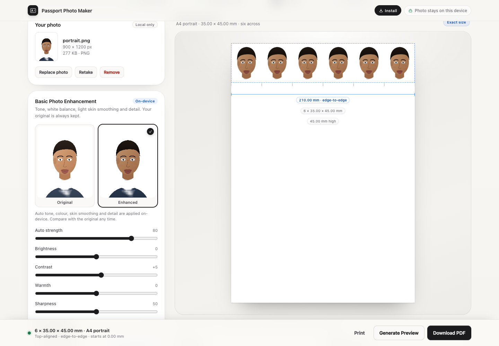
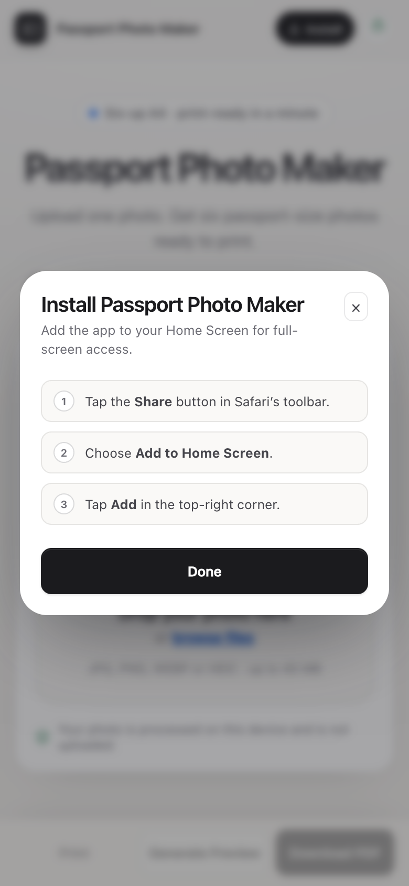
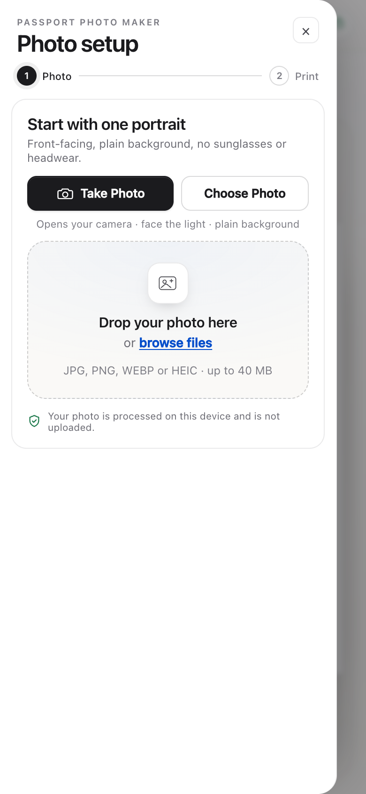
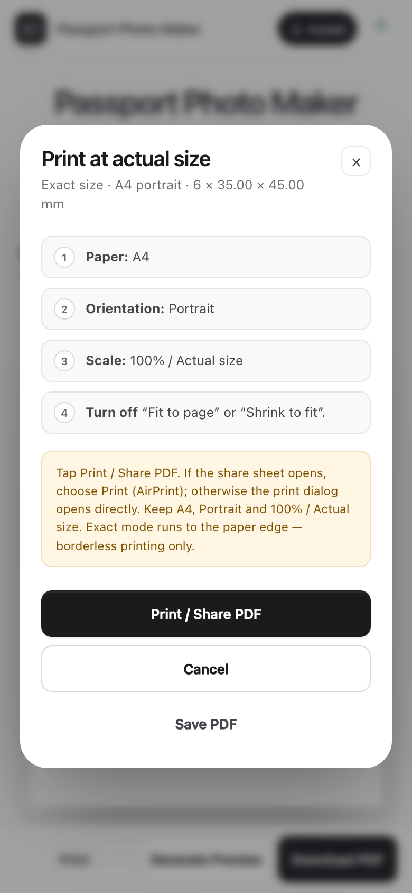
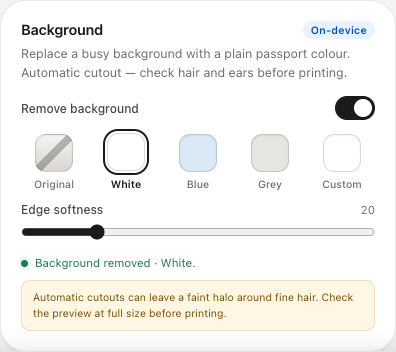

# Passport Photo Maker

A complete, browser-only passport photo tool built from the supplied DeepSeek prompt pack.

Upload one portrait — or take one with your phone camera — → on-device enhancement and background cleanup → exact 7:9 crop → true A4 preview → **six identical 35 × 45 mm photos in one horizontal row** → print-ready PDF or direct print.

Everything runs on the device. There is no backend, no account, no analytics, and no photo upload.

**Live app:** https://sheetomatic.github.io/passport-photo-maker/ — installable as a PWA.



## Run it

Requirements: Node.js 18+ (only to serve static files). There is no build step and no runtime dependency.

```bash
cd passport-photo-maker
npm run dev
```

Open **http://127.0.0.1:5173**.

To use it from a phone on the same Wi-Fi, start the LAN mode instead:

```bash
npm run dev:lan
```

The terminal prints the phone URL (for example `http://192.168.1.24:5173`). Allow the connection if macOS asks about incoming network connections.

`node server.mjs` is a small static server included for convenience. Any static file server that serves `.mjs` as JavaScript and `.wasm` as `application/wasm` works, for example:

```bash
python3 -m http.server 5173
```

Do not open `index.html` directly with `file://` — ES modules and WebAssembly need HTTP.

Tests use `puppeteer-core`, so install dev dependencies once:

```bash
npm install
npm test          # 41 geometry/crop/PDF/print/upload/PWA tests
npm run test:e2e  # real Chrome end-to-end (macOS path auto-detected)
npm run test:all  # both
```

Set `CHROME_PATH` if Chrome lives somewhere else.

### Install it on your phone

Open **https://sheetomatic.github.io/passport-photo-maker/** and add it to your Home Screen.

- **iPhone / iPad (Safari):** tap **Share**, then **Add to Home Screen**.
- **Android (Chrome):** tap **Install** in the app header, or open the browser menu and choose **Install app** / **Add to Home screen**.
- **Desktop Chrome:** use the install icon in the address bar, or the **Install** button in the app header.

The install prompt is available on phones in the header. Once installed, the app opens full-screen without browser chrome and the shell works offline; face detection is cached after its first use.



For local LAN testing, `npm run dev:lan` prints the phone URL (same Wi-Fi; allow incoming connections if macOS asks).

- **Take Photo** uses the phone's native camera through `<input type="file" capture="user">`. That works over plain HTTP and lets the phone switch cameras and confirm/retake in its own camera UI.
- **Print / Share PDF** uses the Web Share API when available (HTTPS or localhost). Choose **Print** in the share sheet for AirPrint.
- Over plain HTTP on your LAN, Web Share is unavailable by browser policy. The app then opens the system print dialog directly with the same exact A4 sheet — no PDF detour required.







## What it does

- **One photo in, six identical photos out.** Every copy uses the same rendered crop and enhancement.
- **True A4 portrait geometry**: 210 × 297 mm, one horizontal row, no extra rows or pages.
- **Two size modes**:
  - **Exact 35 × 45 mm**: edge-to-edge, zero gaps, zero side margins. This is the mathematically exact six-up layout.
  - **Printer-safe**: configurable safe margin and gap; the real reduced dimensions are calculated and shown everywhere. It never calls a reduced photo "35 mm".
- **A4 preview at true proportions** with millimetre measurements, cut guides, and a live metric panel.
- **Top-aligned row by default** (starts at the paper edge in Exact mode, at the safe margin in Printer-safe). The `Centred` option restores the 126 mm middle position, and a nudge control moves the row down.
- **Optional cut marks / hairlines / printed labels**; measurement overlays are preview-only.
- **Photo Enhancement** using Canvas: auto exposure and grey-world white balance, percentile contrast, warmth, vibrance, multi-scale clarity/sharpening, and a low-strength edge-aware skin-smoothing pass. Original is always preserved; Original/Enhanced comparison, adjustable auto strength, and reset.
- **Background removal / replacement**: a local MediaPipe selfie segmenter cuts the subject out of the photo and composites it over white, pale blue, light grey, or a custom colour. Edge softness is adjustable, and the original background can be restored instantly. Automatic cutouts are approximate — the UI says to check hair and ears.
- **Manual 7:9 crop** with drag, wheel/slider zoom, keyboard nudging and reset.
- **Take Photo on mobile** through the native camera, plus Choose Photo, drag/drop, replace and retake. HEIC/HEIF is accepted where the browser can decode it (Safari); other browsers get a clear explanation instead of a silent failure.
- **Optional face suggestion** using vendored MediaPipe Tasks Vision + BlazeFace. It fails gracefully to a centred crop; photo editing never depends on it.
- **PDF download** with jsPDF in millimetres, plus a direct print path that uses an A4, zero-margin print document.
- **Mobile printing**: Print / Share PDF sends the A4 PDF to the share sheet (AirPrint) on supported phones; without Web Share, the same button opens the browser print dialog with a dedicated exact-size print sheet. Save PDF stays available.
- **Mobile-friendly layout**: large camera/choose touch targets, safe-area padding for notched phones, touch-specific crop hints, scrollable print dialog on short screens.
- **Installable PWA**: web app manifest with any/maskable icons, standalone display, a service worker for the offline app shell, and an in-app install flow with iPhone/Android instructions.
- **Privacy**: photos are decoded and processed in memory with Canvas. No network request leaves the page; even the face-detection model and WASM are vendored locally.

## The physical geometry

Six photos at exactly 35 mm = 210 mm, which is the full width of A4. There is no room for gaps, margins, or rounding.

### Exact 35 × 45 mm

```
page      = 210 × 297 mm (portrait)
photos    = 6 × 35 × 45 mm
row width = 6 × 35 = 210 mm
gaps      = 0 mm
margins   = 0 mm
row top   = 0 mm   (top-aligned by default)
row top   = 126 mm (optional Centred position)
```

The row starts at the top edge by default. `Centred` is still available as a one-click alternative, and the nudge slider moves the row down from whichever base you choose. Edge-to-edge printing requires a borderless printer; most office printers have non-printable margins and may clip the outer photos, so the UI warns and offers Printer-safe.

### Printer-safe

With safe margin `m` and gap `g`:

```
photo width  = (210 - 2m - 5g) / 6
photo height = photo width × 45 / 35   (exact 7:9)
row width    = 6 × width + 5g
row x        = margin = m
row top      = margin = m   (Top position; Centred is (297 - height) / 2)
```

Defaults `m = 6 mm`, `g = 2 mm` produce:

```
photo width  = 31.333… mm
photo height = 40.2857… mm
row width    = 198 mm
side margin  = 6 mm
row top      = 6 mm
```

These are the numbers shown in the UI, in the PDF, and in the print document. The app explicitly says **"reduced from 35 mm"** and never claims the reduced photos are 35 mm wide. If both safe margin and gap are set to zero, the photos are again exactly 35 × 45 mm, and the UI says "full 35 mm width" instead of pretending something was reduced.

### Pixel dimensions

Rendered crop width is always a multiple of 7, so the pixel height is an exact integer and the output is exactly 7:9:

| Photo width | 600 dpi render | Effective dpi |
| --- | --- | --- |
| 35 mm | 826 × 1062 px | ≈599 dpi |
| 31.33 mm | 742 × 954 px | ≈602 dpi |

The source crop and target canvas are both 7:9, so images are never stretched.

## Workflow

1. **Upload** — take a photo with the phone camera, choose from the library, or drag/drop; JPG, PNG, WEBP (and HEIC where supported) up to 40 MB. Type and decode failures show a clear error without breaking the current session.
2. **Enhance** — Original/Enhanced toggle, auto strength, brightness, contrast, warmth, sharpness and skin smoothing. The original is untouched.
3. **Background** — switch removal on, pick White/Blue/Grey/Custom, adjust edge softness, or return to Original. The cutout runs locally with the bundled selfie segmenter.
4. **Crop** — locked 7:9 frame; drag to pan, scroll/slider/± to zoom, arrow keys to nudge, Reset Crop. A face is suggested automatically when the local detector loads.
5. **Layout** — Exact or Printer-safe, safe margin, gap, row position (Top default / Centred), nudge, cut guides, print quality (300/600 dpi), printed labels, measurements.
6. **Preview** — live A4 sheet with six copies and measurement overlay; Generate Preview renders the full-resolution print image and verifies every geometry check.
7. **Export** — Download PDF (one page) or Print. On mobile, Print / Share PDF uses the share sheet when available and falls back to the system print dialog; desktop uses the browser's print dialog with the A4 sheet.
8. **Replace / Retake / Remove** — replacing re-renders all six; removing returns to the empty state.

## Print instructions

Desktop print dialog, or the print options behind the mobile share sheet:

- Paper: **A4**
- Orientation: **Portrait**
- Scale: **100% / Actual size**
- Turn off **Fit to page / Shrink to fit**

On a phone:

- **Share / AirPrint available** (HTTPS): tap **Print / Share PDF**, choose **Print** in the share sheet, then confirm A4 / Portrait / 100%.
- **Share unavailable** (plain HTTP): tap **Print / Share PDF** and the browser print dialog opens directly. The temporary print sheet is exactly A4 with the same millimetre layout; it is scoped so normal printing of the app is unaffected.
- **Save PDF** is always available in the mobile print dialog.

Exact mode must be printed borderless. If the printer cannot do that, use Printer-safe. The PDF and print document both carry the same millimetre coordinates; the preview uses the same `computeLayout()` result.

## Project structure

```
passport-photo-maker/
├─ index.html                  # app shell
├─ styles.css                  # visual system, responsive layout, A4 sheet
├─ js/
│  ├─ geometry.js              # A4 maths, modes, guides, verification (source of truth)
│  ├─ image-processing.js      # decode, tone analysis, skin smoothing, background compositing, crop rendering
│  ├─ background.js            # lazy local selfie segmentation for cutouts
│  ├─ crop.js                  # 7:9 crop model, clamping, face framing
│  ├─ face-detect.js           # lazy local MediaPipe loader
│  ├─ app.js                   # state, UI wiring, preview, export
│  ├─ pdf.js                   # jsPDF page and millimetre placements
│  └─ print.js                 # exact print document + iframe printing
├─ vendor/
│  ├─ jspdf.umd.min.js         # pinned jsPDF 2.5.2
│  └─ mediapipe/               # Tasks Vision 0.10.14, BlazeFace, selfie segmenter model
├─ icons/                      # 192/512/maskable/apple-touch/favicon PNGs
├─ manifest.json               # PWA manifest (standalone, relative scope)
├─ sw.js                       # offline app-shell cache + runtime vendor cache
├─ js/pwa.js                   # service worker registration + install UI
├─ .nojekyll                   # GitHub Pages: serve files as-is
├─ tests/
│  ├─ unit/                    # geometry, crop, PDF, print tests
│  ├─ e2e.mjs                  # real-browser acceptance run
│  └─ fixtures/                # generated synthetic test portraits
├─ screenshots/                # app and print-sheet captures from the test run
├─ server.mjs                  # zero-dependency static server
└─ package.json
```

## Verification

Run `npm test`:

- 6 photos × 35 mm = 210 mm, zero gaps/side margins, row top 0 mm (default); Centred = 126 mm; nudge and clamping verified.
- Printer-safe `(210 − 2m − 5g) / 6` and 7:9 ratio at every zoom.
- Pixel outputs have an exact 7:9 ratio.
- PDF `MediaBox` = 595.2756 × 841.8898 pt = 210 × 297 mm; exactly one page; six image draw operations at 35 × 45 mm, evenly spaced, top edge at 0 mm (252 mm from the PDF's bottom-left origin).
- Print CSS uses `@page { size: 210mm 297mm; margin: 0 }`; six images at exact millimetre positions; no body titles.
- Safe mode never claims 35 mm; labels are opt-in.
- Camera-style uploads without an extension, HEIC acceptance, format rejection, empty/oversized files.
- PWA manifest fields, icon dimensions/purposes, screenshots, service-worker precache and navigation fallback, and the install/theme metadata.
- Enhancement reset returns to the new defaults (auto strength, contrast, sharpness, smoothing, warmth).

Run `npm run test:e2e` (real Chrome, headless):

- Empty state and disabled actions; corrupt, unsupported and unreadable HEIC files rejected.
- Upload → live preview with six identical images; sheet photo positions measured in the browser: 35 × 45 mm at 0, 35, 70 … 175 mm, top 0 mm.
- Printer-safe top margin, Top/Centred placement, and downward nudging.
- Printer-safe: 31.33 × 40.29 mm, 6 mm margins, 2 mm gaps; zero-margin case reports "full 35 mm width".
- Measurements, guides, preview labels, and row position.
- Zoom/drag/reset, Original/Enhanced, adjustment reset.
- Generate Preview → all geometry checks pass.
- PDF bytes and **actual downloaded file**: one A4 portrait page.
- Print stylesheet measured in a browser and printed to PDF: one page, correct page size.
- Desktop print dialog and instructions.
- Replace photo updates all six copies; remove returns to the empty state.
- **Mobile emulation** (iPhone UA, touch, 390 × 844): Take Photo/Choose Photo visible, `capture="user"` camera input path loads the photo, Retake visible, no horizontal overflow.
- **Mobile share path**: stubbed Web Share receives a real `application/pdf` File of the print sheet.
- **Background removal**: white and pale-blue cutouts measured at the sheet corners, Original restored on toggle, and the full-resolution export canvas checked for a white background.
- **Mobile print fallback**: with sharing disabled, the direct print portal opens with six 35 × 45 mm photos, measured in print media, and produces exactly one A4 page.
- **Live GitHub Pages deploy**: installability errors empty, service worker controlling the page, six photos and face detection working on the deployed HTTPS origin, and an offline reload rendering the app shell.
- Face detection blocked at the network layer → warning status, six-photo manual flow still works.
- **PWA installability** via Chrome's `Page.getInstallabilityErrors`: no errors; standalone manifest, three icons and a service worker.
- **Offline launch**: after service-worker activation, a reload with networking disabled still renders the app shell.
- **No external network requests** during the whole run.
- No page errors.

## Live deployment

The public site is hosted on **GitHub Pages** from the `main` branch at
https://sheetomatic.github.io/passport-photo-maker/. `.nojekyll` keeps the static
files untouched. HTTPS gives the service worker, install prompt, camera and Web
Share a secure context.

Redeploy after changes:

```bash
git add . && git commit -m "Update app" && git push
```

The service worker caches a versioned shell. Bump `CACHE_VERSION` in `sw.js`
when changing shell assets so returning visitors receive the new build.

## Browser support

- Chrome / Edge 91+, Safari 16.4+, Firefox 90+.
- PWA installation: Chrome/Edge/Android, Safari on iOS/iPadOS. Service workers require HTTPS or localhost.
- Camera capture uses the platform camera picker; this is a secure-context-independent native input.
- Web Share with files needs a secure context (HTTPS or localhost). The direct print fallback covers plain HTTP.
- Face detection needs WebAssembly SIMD (all current mainstream browsers). If it cannot load, the app says so and falls back to a centred 7:9 crop; every other feature works offline.
- HEIC/HEIF decoding depends on the browser; Safari on Apple platforms works, most desktop browsers do not. The app explains this if a HEIC file cannot be decoded.
- The face model and all libraries are loaded from `vendor/` — no CDN.

## Limitations

- This is a print-sheet tool, **not an official compliance guarantee**. Passport rules vary by country; check requirements (head size, background, expression, recency) before submitting.
- Automatic background cutouts are approximate around fine hair and thin straps. Inspect the preview at full size, or keep the original background, when edges matter.
- The layout is intentionally fixed to six identical photos in one row on A4 portrait.
- Exact mode depends on borderless printer hardware.
- Very large images are downscaled to 3200 px on the long edge before processing, which is far above the 826 px print requirement.
- The mobile direct-print path relies on the browser's print implementation; the PDF path is the exact, portable fallback.
- AirPrint/share availability depends on the browser and context, not the app.
- Face detection is a suggestion, not a guarantee; use the manual crop whenever framing matters.

## Privacy

All decoding, enhancement, background segmentation, face detection, PDF generation and printing happen in the browser. The app makes no external requests. Photos are held in memory only and are never uploaded or persisted; no object URLs are left dangling.

## Third-party notices

See [THIRD_PARTY_NOTICES.md](THIRD_PARTY_NOTICES.md). jsPDF is MIT-licensed; MediaPipe Tasks Vision and BlazeFace are Apache-2.0.
